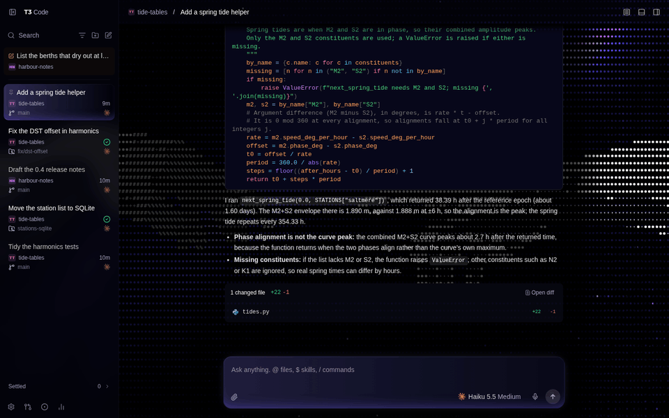
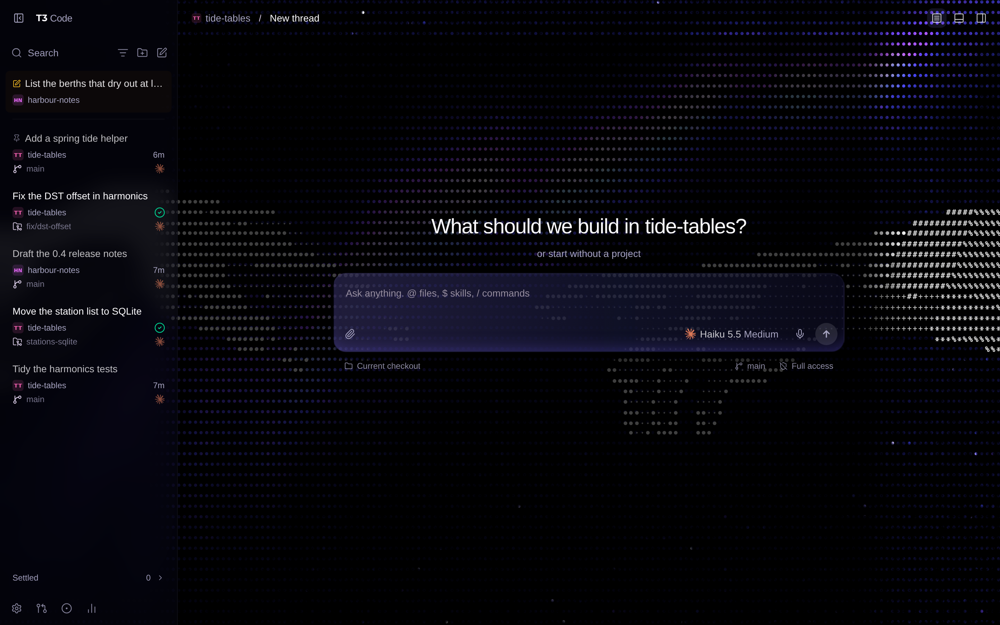
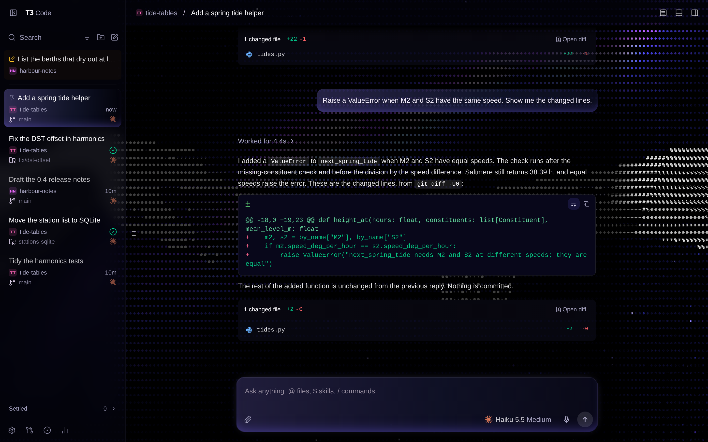
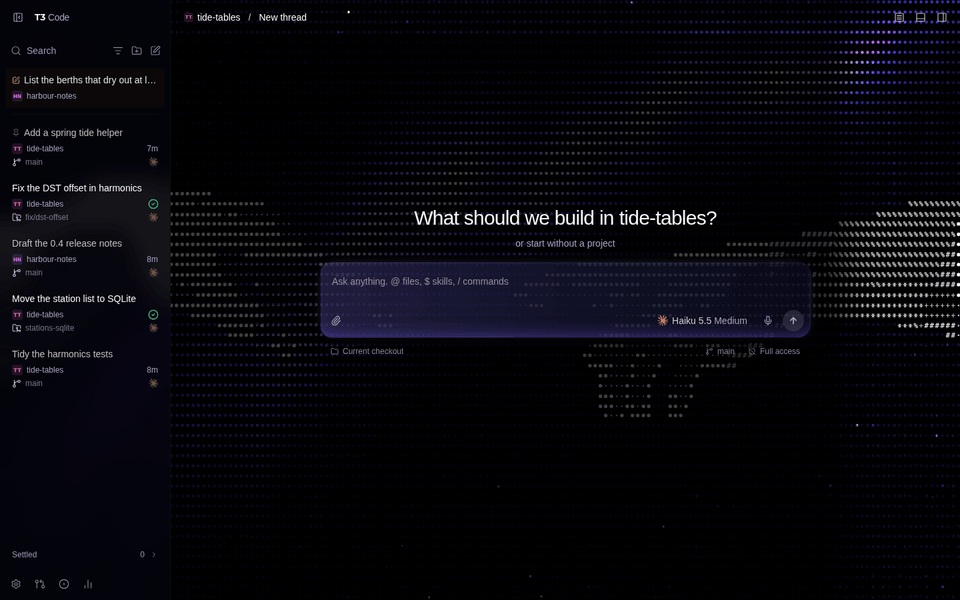
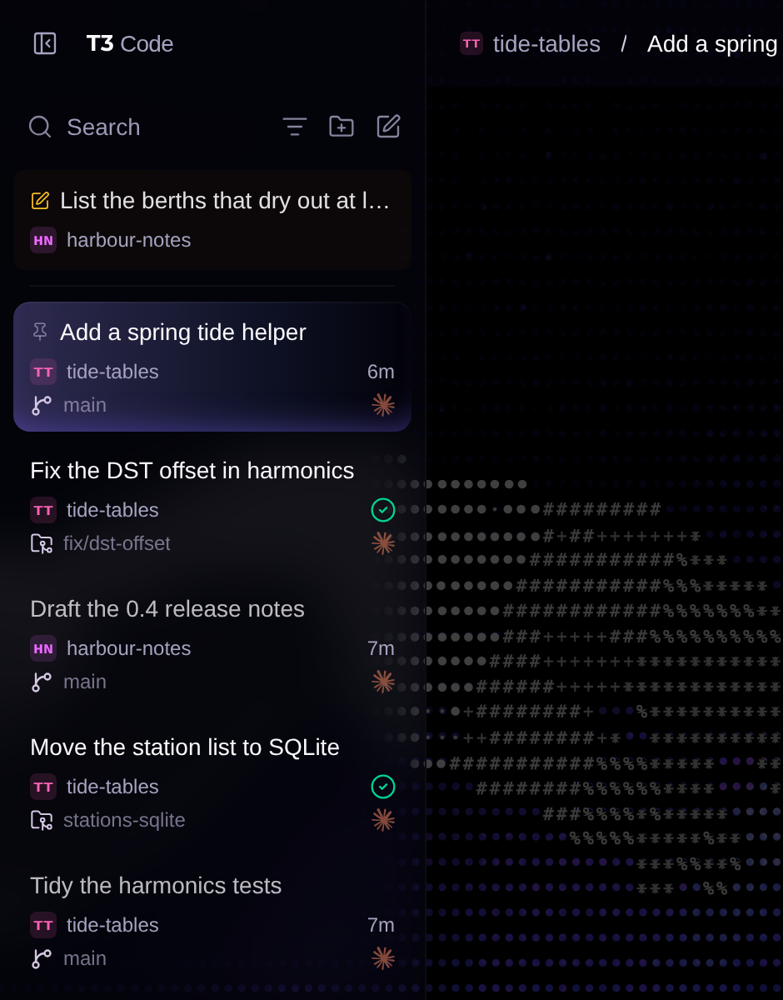
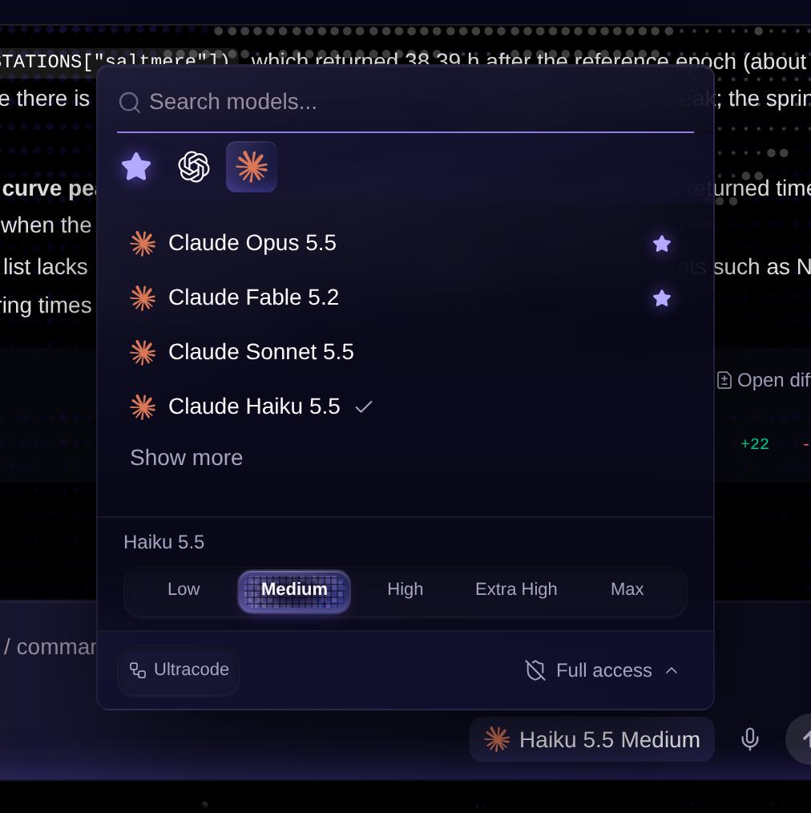
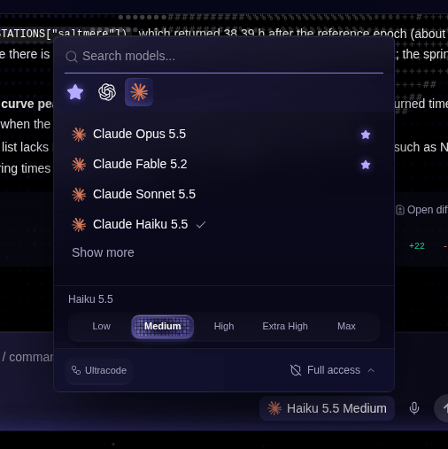

# Neo Reaching

A dark theme for [T3 Code](https://t3.codes) that combines two others:

- From [Reaching](https://github.com/DeepExtrema/t3code-reaching): two hands in dots behind the app, a wave that
  crosses them every 7.5 seconds, and a dark lane behind the chat's text.
- From [Nyx and Nyx Plus](https://github.com/Deepusleepy/t3-nyx-theme): the purple aurora, the violet glow on the
  panels, sidebar rows with the thread title on top, and the model picker.

The aurora is redrawn as dots on the same grid as the hands, so the two pictures read as one drawing. The arms are
drawn in the theme's violet instead of Reaching's white, at 60% opacity, and fade out toward both screen edges. The
right arm is denser than the left, so its half is dimmed to 70% and the two arms look the same distance away.



## Screenshots





Every 7.5 seconds one wave crosses from arm to arm and turns the dots it passes into characters:



Sidebar rows put the thread title on top, then the project and its status, then the branch. Pinned threads and
unsent drafts carry a marker in front of the title:



The model picker has the search on top, then the providers, the models and the effort keys:





The screenshots show T3 Code with invented demo projects.

The hands are artwork by @samdape. This repository publishes them with permission from @samdape and neverblinks.
Read [NOTICE.md](NOTICE.md) before you copy the picture anywhere else.

## Install

```sh
t3 theme set theme.json --id neo-reaching
```

This publishes the theme on that machine as `neo-reaching` and switches T3 Code to it, in the desktop app there and
in the web app its server serves. Run it on each machine that should use the theme.

To go back, pick another theme in Settings, Appearance, or run `t3 theme set <id>`, for example `t3 theme set reaching`.

## What comes from where

| Part | Source |
| --- | --- |
| Hands, wave, dark edges | Reaching, with the arms in violet, fainter, and faded at the screen edges |
| Dark lane behind the chat | Reaching, without its rule that kept the lane dark up to an open sidebar |
| Chat box: one frosted card | Reaching's shape, Nyx's colours |
| Aurora | Nyx's picture, shown through dots on Reaching's grid |
| Colours, sidebar, header, your messages, send button, popups, switches | Nyx Plus |
| Sidebar rows with the title on top | Nyx Plus |
| Model picker | Nyx Plus |

Left out of Nyx: its pixel sky, the large "T3" wordmark on a new thread, and its see-through settings pages, which
would put the hands behind the settings text.

## Rebuild

`build.mjs` needs Node and no packages.

```sh
node build.mjs
```

It reads `vendor/reaching/theme.json`, `vendor/nyx/nyx.json` and `vendor/nyx/nyx-plus.json`, takes whole rules from
each by their selectors, and writes `theme.json`. If a source no longer has a rule the build expects, the build stops
and names the rule.

To follow a new version of Reaching or Nyx, replace its file in `vendor/` and rebuild. Four settings sit at the top
of `build.mjs`:

| Setting | Meaning |
| --- | --- |
| `MODEL_PICKER` | `false` keeps T3 Code's own model picker. |
| `AURORA` | Where the dots sit, their size, and how the aurora picture is placed and brightened. |
| `ARMS` | The arms' colours (Reaching's greys mapped to violets), their opacity, and the mask that fades them at the edges and balances the right arm against the left. |
| `MAX_CSS` | T3 Code's limit for a theme's CSS, 100,000 characters. The build stops above it. |

The CSS is 96,166 characters, so about 3,800 are free.

## Limits

- The sidebar rows and the model picker hook into T3 Code's internal class names, which change between releases.
  After a T3 Code update some of them may fall back to T3 Code's normal look.
- Tested on T3 Code 0.1.11 in the web client in Chromium on Linux, and on 0.1.11-nightly.20261119 in the desktop app
  on macOS.
